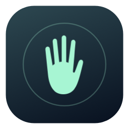
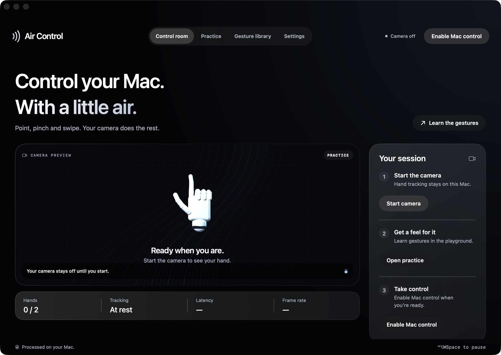
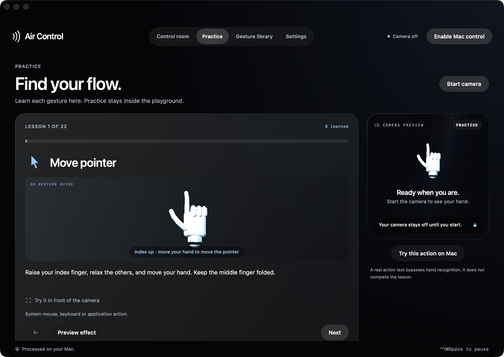
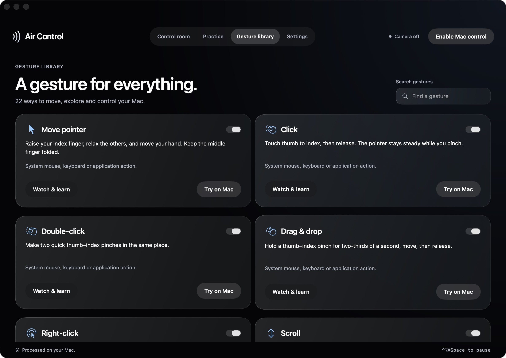
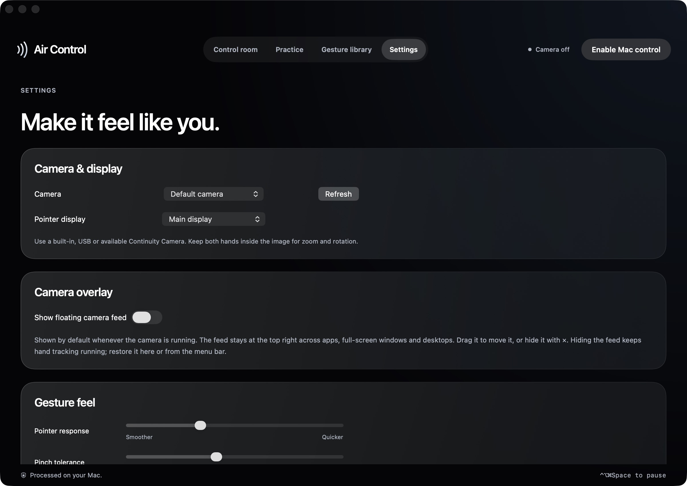
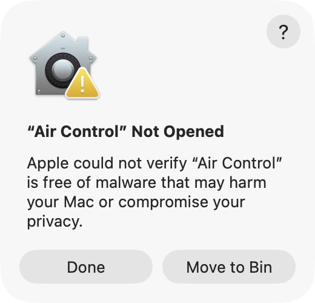
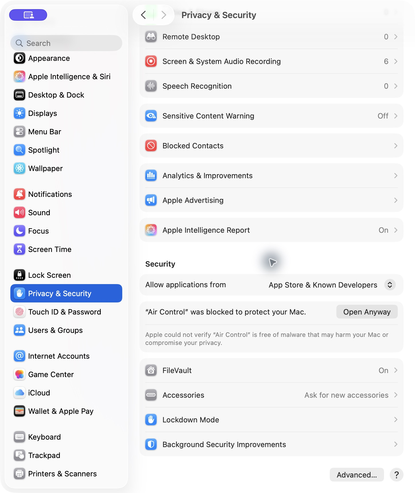
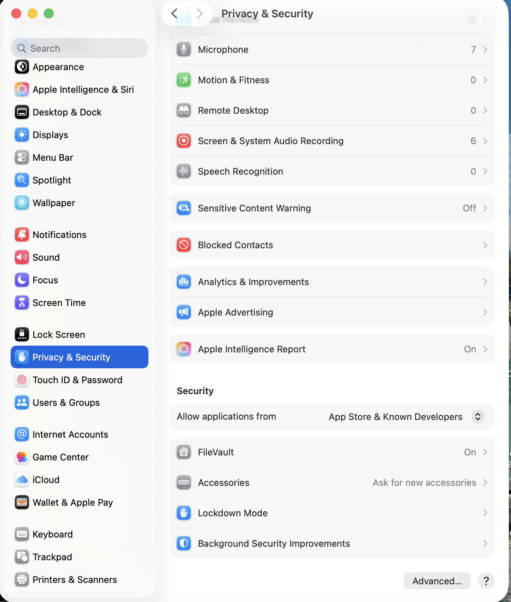
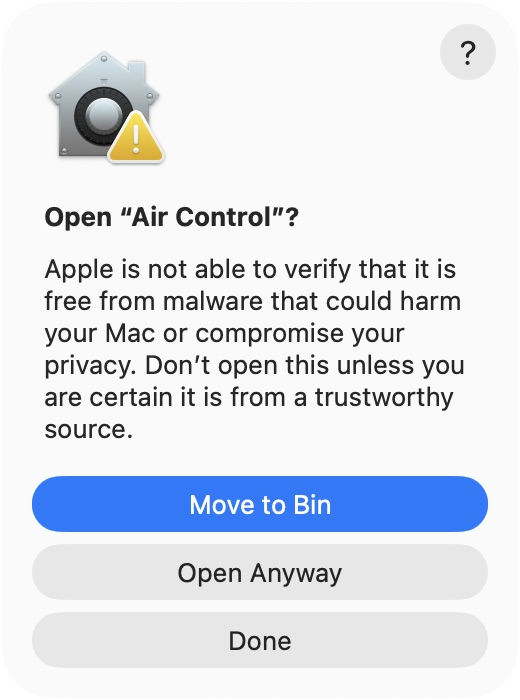
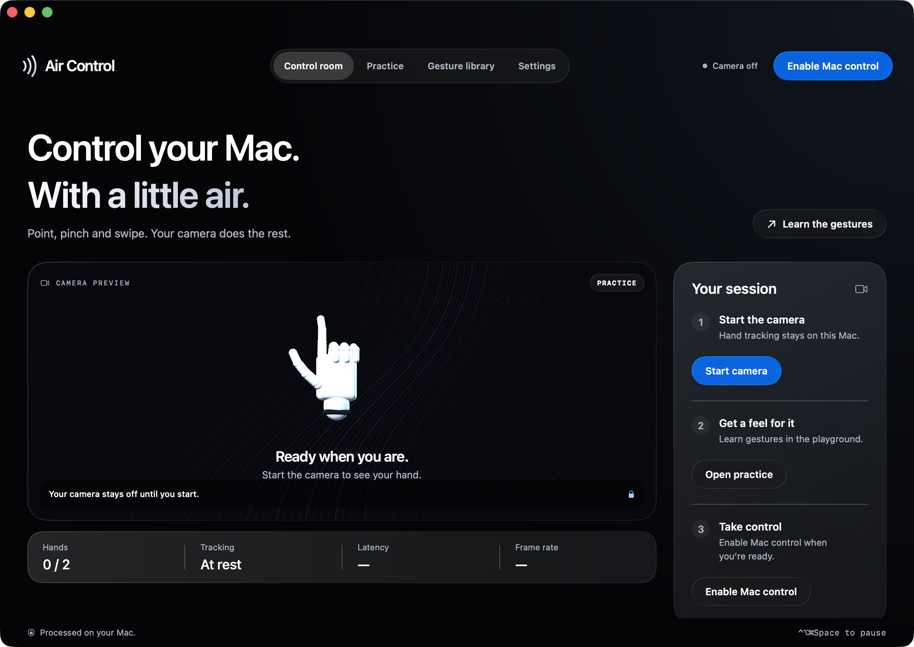

> [!TIP]
> ### ⭐ Like Air Control? Star this repository!
> Help more people discover hands-free Mac control. **[Give Air Control a star on GitHub ↗](https://github.com/pathakcodes/air-control)** — it means a lot, and it’s free.

<div align="center">
  <a href="https://pathakcodes.github.io/air-control/"></a>
  <h1>Air Control</h1>
  <h3>Your Mac. At your fingertips.</h3>
  <p>Hand gesture control for Mac. Point, pinch, scroll and switch desktops<br>using your camera — with on-device hand tracking.</p>
  <p>
    <a href="https://github.com/pathakcodes/air-control/releases/tag/v0.6.0"></a>
    
    
    
    <a href="https://github.com/pathakcodes/air-control/stargazers"></a>
  </p>
  <p><a href="https://github.com/pathakcodes/air-control/releases/download/v0.6.0/Air-Control-0.6.0-arm64.dmg"></a></p>
  <p><a href="https://pathakcodes.github.io/air-control/"><b>Explore the website ↗</b></a> &nbsp; · &nbsp; <a href="https://pathakcodes.github.io/air-control/#install">Install guide</a> &nbsp; · &nbsp; <a href="https://github.com/pathakcodes/air-control/releases">Releases</a> &nbsp; · &nbsp; <a href="https://github.com/pathakcodes/air-control/issues">Feedback</a></p>
  <br>
  <a href="https://pathakcodes.github.io/air-control/#experience"></a>
  <p><sub>Actual app screenshot. Camera off. Native Liquid Glass on macOS 26+, frosted materials on earlier supported systems.</sub></p>
</div>

## ✨ A little movement. A lot you can do.

- **Point to move.** Raise your index finger and move your hand to guide the pointer.
- **Pinch to click.** Touch thumb to index, then release. Hold longer to drag and drop.
- **Swipe between desktops.** Sweep an open hand left or right to change Spaces. Swipe up for Mission Control and down for App Exposé.
- **Navigate your apps.** Scroll, move through browser history, switch apps, show the desktop and open Notification Center.
- **Learn all 22 gestures.** Follow articulated 3D hand animations and explore the practice playground before enabling system input.
- **Try each action.** Gesture library → Try on Mac lets you select a target app and test an action after a countdown.
- **Keep a guide nearby.** A floating camera feed follows across apps and desktops, with gesture instructions and action feedback. Hide it anytime.
- **Make it yours.** Choose your camera and display, then adjust pointer response, pinch tolerance, swipe travel and scroll speed.

## 🖼️ Take a closer look

<details>
<summary><b>Practice — learn with 3D hand guides</b></summary>
<br>

<p>Practice stays inside the playground. Camera recognition completes lessons; preview buttons demonstrate effects.</p>
</details>

<details>
<summary><b>Gesture library — explore and test all 22 gestures</b></summary>
<br>

<p>Search for a gesture, watch its lesson, test its action or disable it individually.</p>
</details>

<details>
<summary><b>Settings — make it feel like you</b></summary>
<br>

<p>Control camera selection, display selection, gesture sensitivity and the floating guide.</p>
</details>

## 📦 Installation

**Requirements:** Apple silicon Mac (M1 or later), **macOS 13+**, and a working camera. This beta is **arm64 only**. Intel support will follow testing.

1. **Download and install.** Get the [0.6.0 DMG](https://github.com/pathakcodes/air-control/releases/download/v0.6.0/Air-Control-0.6.0-arm64.dmg), open it and drag **Air Control** to **Applications**. Copy the **Air Control.app** icon inside the DMG, not the DMG file itself. Eject the image and launch the app from Applications.
2. **Approve the first launch.** If “Air Control” Not Opened appears, choose **Done**, then **System Settings → Privacy & Security → Open Anyway**. In the next “Open Air Control?” dialog, choose **Open Anyway** again (or **Open**, depending on macOS). See the [screenshot walkthrough below](#first-launch-security-warning).
3. **Allow Camera access.** Click **Start camera** and approve Camera access. Keep your full hand in view with light in front of you.
4. **Learn, then take control.** Open **Practice** first. Click **Enable Mac control**, allow Air Control in **Privacy & Security → Accessibility**, return to the app and enable control again.
5. **Set up desktop navigation.** Create at least two desktops in Mission Control. Enable default **Control–Arrow** shortcuts and **F11** under **Keyboard → Keyboard Shortcuts → Mission Control**.

> **✊ Pause anytime:** hold a closed fist for one second, use Pause in the menu bar, or press **Control + Option + Command + Space**. Mac control never starts automatically after relaunch.

Keep the installed app in Applications. Each Mac needs its own permission approval. After an update, macOS may require refreshing Air Control’s existing Accessibility entry. [Release notes and SHA-256 checksum ↗](https://github.com/pathakcodes/air-control/releases/tag/v0.6.0)

## First launch security warning

**Tested on 31 October 2026:** Air Control 0.6.0 downloaded and copied into Applications on **macOS 26.6.2**. The app opened after the approval below, and a quit/relaunch opened normally without another security warning.

This free beta is **ad-hoc signed, without a Developer ID certificate or Apple notarization**. macOS therefore cannot verify it through Apple's distribution checks. Only approve it if you trust the download from this repository. These screenshots show the actual macOS prompts from that test.

### 1. Keep the app and choose Done

Open **Applications → Air Control**. If you see **“Air Control” Not Opened** with “Apple could not verify…”, click **Done**. Choosing **Move to Bin** removes the app instead.



### 2. Allow this app in Privacy & Security

Open **System Settings → Privacy & Security** and **scroll down to the Security section**, below the app-permission categories. After the blocked launch, look for this message underneath **Allow applications from**:

> **“Air Control” was blocked to protect your Mac.**
>
> Click **Open Anyway** beside this message.



*Before approval: the Air Control message and Open Anyway button appear under Security.*

<details>
<summary><b>Where to find Security — screenshot after approval</b></summary>
<br>

<p>This screenshot shows where the Security section is. The Air Control message disappears after successful approval, so it is no longer visible here.</p>
</details>

If that entry is missing, try opening Air Control from Applications once more, dismiss its warning with Done, then return to Privacy & Security. On an organization-managed Mac, your administrator may prevent this exception.

### 3. Confirm Open Anyway in the second dialog

macOS shows **Open “Air Control”?**. On the tested macOS version, the button is **Open Anyway** again — it is not labelled simply Open. Other macOS versions may say **Open**. Approve Touch ID or your Mac login password yourself if macOS requests authentication.



### 4. Start the camera, then enable control

Air Control opens in the **Control room**. Click **Start camera** and allow Camera access. Use **Practice** first, then **Enable Mac control** and allow Air Control under **Privacy & Security → Accessibility**. Return to Air Control and enable control again. An existing permission may already be valid on an updated installation.

<details>
<summary><b>Screenshot: the installed app after successful approval</b></summary>
<br>

</details>

The exception applies to this app; the test left the system's general app-security setting unchanged. You do not need to disable Gatekeeper or run a command to remove quarantine. For alerts saying the app **will damage your computer** or **is damaged**, stop and check the download or [report the exact warning](https://github.com/pathakcodes/air-control/issues) instead of following this approval walkthrough. See [Apple's official app-opening guidance](https://support.apple.com/en-us/102445).

## 🔒 On your Mac. Under your control.

Hand tracking runs locally with **Apple Vision**. Air Control does **not upload or record your camera feed**. There’s no account or cloud processing, and the camera stays off until you start it.

## 🧭 Compatibility

Mouse actions use standard macOS events. Navigation depends on your system shortcuts and the target app. Zoom uses keyboard steps in **Safari, Chrome, Edge, Firefox and Preview**; reset uses Command–0. Rotation uses **90° steps in Preview**.

Air Control does not add a touchscreen, haptics or pressure sensing. Recognition quality varies with lighting, camera, hand position and distance. [Explore every gesture and its limits ↗](https://pathakcodes.github.io/air-control/#gestures)

## 💬 Help shape the beta

Found something unexpected? [Open an issue](https://github.com/pathakcodes/air-control/issues) with your macOS version, camera, gesture and what happened. Please avoid sharing private camera images.

**⭐ Enjoy using it? [Star Air Control](https://github.com/pathakcodes/air-control) and share the [product page](https://pathakcodes.github.io/air-control/).**

## 🛠️ About this repository

This repository contains the **public product website and download releases**. The native app’s Swift source is not included here. The website is dependency-free HTML, CSS and JavaScript, served by GitHub Pages from the root of `main`.

Preview locally:

```sh
python3 -m http.server 4173
# Visit http://localhost:4173
```

When releasing an update, update the versioned download links, app metadata, README badges and sitemap date together. The sitemap is at [`sitemap.xml`](https://pathakcodes.github.io/air-control/sitemap.xml). Search indexing and rankings are controlled by search engines.

<div align="center">
  <br>
  <sub>An independent project. Not affiliated with or endorsed by Apple. Mac and macOS are trademarks of Apple Inc.</sub>
</div>
